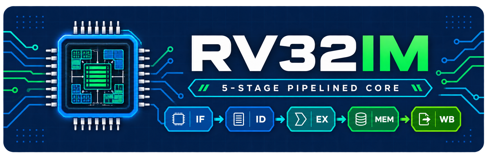
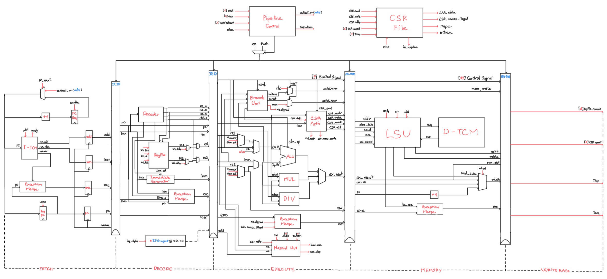
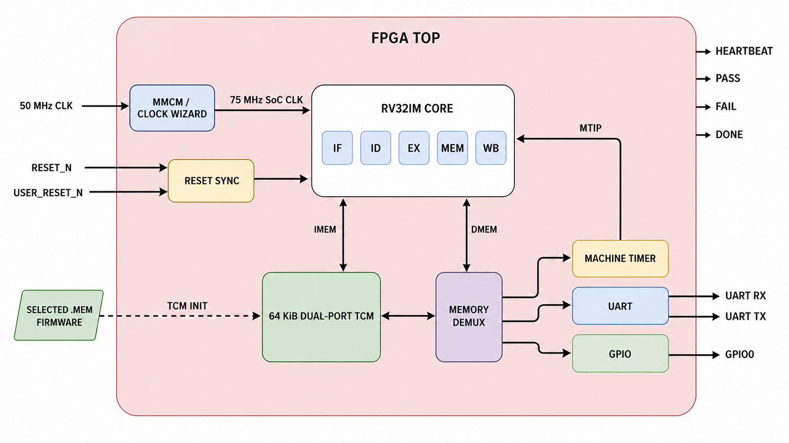
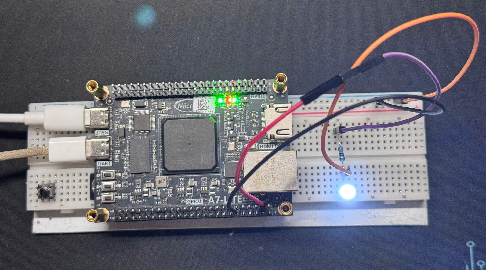
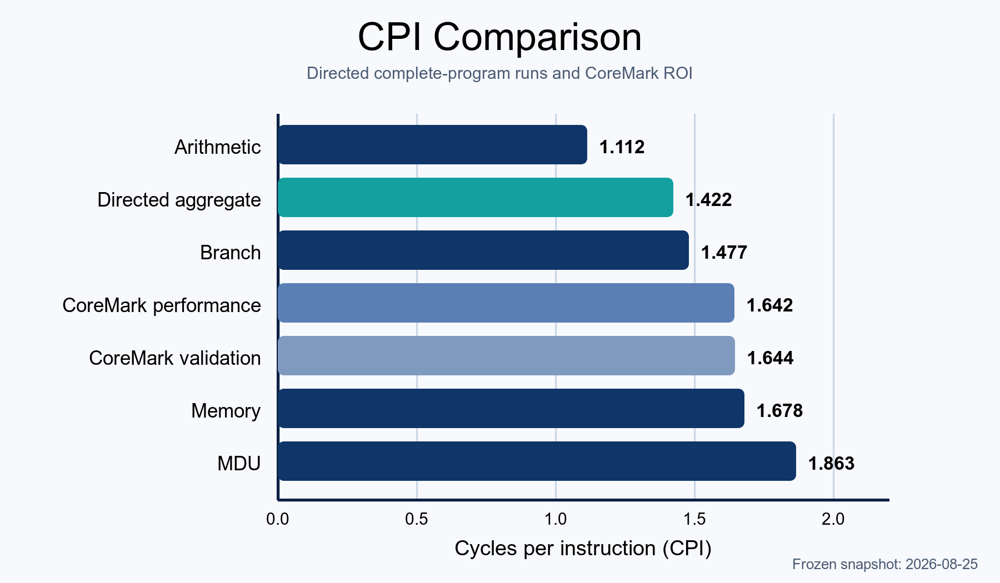

# RV32IM 5-Stage RISC-V Core & FPGA SoC

[](https://github.com/vohoangnguyennnn/riscv-rv32im-core/actions/workflows/rtl-regression.yml)
[](https://github.com/vohoangnguyennnn/riscv-rv32im-core/actions/workflows/act4-regression.yml)
[](https://github.com/vohoangnguyennnn/riscv-rv32im-core/releases/tag/v1.0.0)
[](rtl)
[](docs/architecture.md)
[](LICENSE)



A synthesizable, single-issue, in-order RV32IM processor and compact SoC,
taken from RTL through bare-metal software, FreeRTOS, multi-level
verification, Vivado implementation, and deployment on a Xilinx Artix-7 board.

Every result below is reproducible from this repository or traceable to the
hash-identified [`v1.0.0` release](https://github.com/vohoangnguyennnn/riscv-rv32im-core/releases/tag/v1.0.0);
provenance and claim boundaries are recorded in
[Hardware validation](docs/hardware-validation.md).

[Results](#key-results) · [Quick start](#quick-start) · [Architecture](#architecture) · [SoC & software](#soc-and-software) · [Verification](#verification) · [FPGA](#fpga-implementation) · [Performance](#performance) · [Docs](#documentation)

## Key results

| Area | Result |
|---|---|
| Core | 5-stage IF/ID/EX/MEM/WB, single-hart, single-issue, in-order RV32IM |
| Privileged support | Machine-mode CSR subset, precise synchronous traps, machine-timer interrupt, `ECALL`/`MRET` |
| RTL regression | Strict lint; 21/21 unit, 7/7 directed integration, and FreeRTOS SoC simulations pass |
| Software | 2/2 bare-metal programs and the FreeRTOS V11.3.0 demo pass on Verilator and Questa |
| ISA suites | 40 RV32I + 8 RV32M pinned `riscv-tests`; 39 RV32I + 8 RV32M ACT4 4.0.0 (Sail-backed) |
| FPGA target | MicroPhase A7-Lite R1.1, AMD/Xilinx Artix-7 `xc7a35tfgg484-2` |
| Implementation | Vivado 2024.1, fully routed at 75 MHz; setup WNS +0.070 ns, hold WHS +0.066 ns, 0 DRC errors |
| Utilization | 3,815 LUT (18.34%), 2,001 FF (4.81%), 16 BRAM (32.00%), 4 DSP (4.44%), 10 bonded I/O |
| Power | 0.253 W vectorless post-route estimate, Medium confidence; not board-measured |
| Directed performance | 35,245 instructions in 50,101 cycles; CPI 1.422, IPC 0.703 |
| CoreMark | 2.127 CoreMark/MHz (CRC-valid performance run, CPI 1.642) |
| Board bring-up | Released bitstream validated for boot, UART echo, GPIO, PASS/DONE, and both reset paths |

The `v1.0.0` release packages the programmable bitstream, FreeRTOS ELF and
`.mem` image, Vivado evidence archive, artifact manifest, and SHA-256 sums. The
bitstream was implemented from clean commit `fc57a72` with
`TCM_INIT_FILE=freertos_demo.mem`.

## Engineering highlights

- Built a complete scalar datapath around explicit valid/kill/stall semantics, with EX/MEM and MEM/WB forwarding and a load-use interlock.
- Implemented RV32M with a registered two-stage multiplier and a radix-2 restoring divider behind request/response handshakes, with precise retirement.
- Split instruction and data memory ports with stable held requests and at most one outstanding transaction per port.
- Brought up a 64 KiB TCM SoC with machine timer, UART, GPIO, completion mailbox, and a pinned FreeRTOS kernel.
- Verified the design with directed RTL tests, bound SVA, software runs, two simulators, two external ISA suites, and FPGA deployment.
- Tied every performance and hardware claim to reproducible counters, frozen reports, or hashed artifacts.

## Quick start

### Requirements

- GNU Make, Python 3, and Git
- Verilator 5.x
- Bare-metal RISC-V GCC (default prefix `riscv64-unknown-elf-`; override with `CROSS_COMPILE=...`)
- Optional: Questa for cross-simulation, Vivado 2024.1 for FPGA implementation, and the ACT4 prerequisites checked by `make act4-check-tools` (including `sail_riscv_sim` 0.10 and `mise`, Linux/x86_64)

### Run the public regression

The vendored `riscv-tests` RV32 wrappers include instruction bodies from the
upstream `rv64ui`/`rv64um` directories, which are not committed. Restore them at
the pinned commit once (the same step CI performs; both directories are
git-ignored):

```bash
git clone https://github.com/vohoangnguyennnn/riscv-rv32im-core.git
cd riscv-rv32im-core

RISCV_TESTS_COMMIT=447a5fcb8253627ddb5f6a226f64e43463afcdd5
git clone --filter=blob:none --no-checkout \
  https://github.com/riscv-software-src/riscv-tests.git /tmp/riscv-tests
git -C /tmp/riscv-tests fetch --depth 1 origin "$RISCV_TESTS_COMMIT"
git -C /tmp/riscv-tests checkout --detach "$RISCV_TESTS_COMMIT"
cp -R /tmp/riscv-tests/isa/rv64ui /tmp/riscv-tests/isa/rv64um third_party/riscv-tests/isa/

make -j"$(nproc)" test
```

`make test` runs strict lint, 29 RTL simulations (21 unit, 7 directed
integration, 1 FreeRTOS SoC), two bare-metal programs, and 48 pinned ISA
programs. Generated models and images are written below `/tmp/rv32im-core-*`.

### Other targets

| Command | Purpose |
|---|---|
| `make lint` / `make unit` / `make integration` | Individual stages of the public gate |
| `make assertions` | Protocol, retirement, and interrupt SVA stress benches |
| `make baremetal` / `make freertos` / `make isa` | Software and ISA stages of the public gate |
| `make fpga` | **Simulation only:** reset synchronizer and SoC/TCM deployment-support tests |
| `make fpga-freertos-images` | Build the 75 MHz, 250 ms-blink FreeRTOS board image |
| `make benchmark` / `make coremark` | Directed CPI/IPC workloads and CoreMark; reports go to `build/generated-reports/` |
| `make act4` | Separate Sail-backed ACT4 RV32I/RV32M suite (47 tests) |
| `make questa-check` / `make questa-freertos-run` | Local Questa cross-checks |
| `make <testbench>` | Run one test, for example `make tb_div_unit` |
| `make help` | All targets and tool overrides |

Vivado implementation is not a Make target. Build the board image with
`make fpga-freertos-images`, then follow the project-creation, Clocking Wizard,
and release-export steps in [FPGA §6](docs/fpga.md#6-vivado-implementation-flow).
To program a board without rebuilding, use `fpga_top-v1.0.0-freertos.bit` from
the [release](https://github.com/vohoangnguyennnn/riscv-rv32im-core/releases/tag/v1.0.0).

## Architecture

| Property | Implementation |
|---|---|
| ISA | RV32I 2.1, full RV32M 2.0, six Zicsr 2.0 operations, `MRET`, and no-op `WFI` |
| Privilege | Machine mode only; documented CSR subset; no caches, MMU, or PMP |
| Control transfer | Branch/`JAL`/`JALR`/`MRET` resolved in EX; taken transfers flush two younger packets |
| Traps | Precise synchronous exceptions and machine-timer interrupt (cause 7), committed at WB |
| Memory | Independent instruction/data request-response ports, little-endian |
| RV32M | Two-stage registered multiply; 32-iteration divide with local corner-case results |
| Observability | Retirement trace, trap trace, `mcycle`/`minstret`, and diagnostic stall counters |

[](docs/images/pipeline_datapath.jpg)

*Annotated logical datapath of the implemented core; select the image for full resolution.*

Pipeline control is centralized around architectural validity:

- EX/MEM and MEM/WB hold while memory or MDU responses are pending.
- Forwarding prefers the younger EX/MEM source over MEM/WB; loads add a one-cycle load-use interlock.
- Redirects and traps invalidate younger instructions before they can retire or commit stores.
- Flushes dominate stalls, so redirect and trap handling stay precise under back-pressure.
- Divide-by-zero and signed overflow return the RV32M-defined results without trapping.

Details: [Architecture](docs/architecture.md) and [Pipeline control](docs/pipeline-control.md).

## SoC and software

The SoC integrates the core with a unified true-dual-port TCM, a
transaction-owning memory demultiplexer, and three memory-mapped peripherals.



*75 MHz MMCM clocking, reset synchronizer, five-stage core, dual-port TCM, demultiplexer, timer, UART, GPIO, and board status outputs.*

| Region | Address | Role |
|---|---|---|
| TCM | `0x0000_0000`–`0x0000_FFFF` | 64 KiB instruction/data memory; completion (`tohost`) word at `0x0000_FFFC` |
| Timer | `mtimecmp` `0x0200_4000`/`0x0200_4004`, `mtime` `0x0200_BFF8`/`0x0200_BFFC` | MTIP interrupt source |
| UART | `0x1000_0000` | Polled 115200 8N1 console |
| GPIO | `0x1001_0000` | 32-bit input/output registers; output bit 0 reaches JP2 on the board |

The software stack provides startup code, linker scripts, trap entry, a
freestanding ILP32 runtime and BSP, bare-metal tests, benchmarks, a CoreMark
port, and a pinned FreeRTOS Kernel V11.3.0 demo built on the official GCC
RISC-V port. The frozen FreeRTOS simulation shows preemptive scheduling of the
`blink`, `echo`, and `check` tasks with 5 machine-timer traps, 13 `ECALL`
yields, 18 `MRET` retirements, 3 GPIO transitions, UART `READY\n` output, and
`0xA5` echo, with matching results in Verilator and Questa.

Details: [Software](docs/software.md).

## Verification

| Layer | Coverage | Entry point | In `make test` |
|---|---|---|:---:|
| Static RTL | Strict Verilator lint of synthesizable boundaries | `make lint` | ✓ |
| Unit | 21 benches: datapath, stages, control, MDU, LSU, TCM, peripherals | `make unit` | ✓ |
| Integration | 7 benches: forwarding, waits, traps, MTIP, control recovery, SoC | `make integration` | ✓ |
| Software | 2 bare-metal programs and the FreeRTOS SoC demo | `make baremetal freertos` | ✓ |
| ISA | 48 pinned `riscv-tests` RV32I/RV32M programs | `make isa` | ✓ |
| Assertions | Memory-protocol, retirement, and interrupt SVA | `make assertions` | |
| Independent ISA | 47 ACT4 4.0.0 RV32I/RV32M tests against Sail | `make act4` | |
| Cross-simulator | Curated RTL portfolio and FreeRTOS on Questa | `make questa-check` | |

CI runs `make test` on every push and pull request, and runs ACT4 when the
RTL, assertions, ACT4 configuration, or Makefile change. Pass/fail comes from
self-checking benches, architectural signatures, and a retirement-qualified
completion store, not from simulator exit status or waveforms.

Details, requirement traceability, and open verification work:
[Verification](docs/verification.md).

## FPGA implementation



*FreeRTOS running on the MicroPhase A7-Lite; the released bitstream passed the recorded board checks.*

The design uses the board's 50 MHz oscillator and a 75 MHz MMCM-generated SoC
clock in one functional clock domain. Firmware is loaded through
bitstream-initialized TCM block RAM. Board observability comprises heartbeat
and PASS LEDs, DONE/FAIL outputs on JP2, the CH340 UART, and GPIO output bit 0.

All 6,890 setup/hold endpoints meet timing at the 75 MHz target, with zero
unclocked or unconstrained endpoints. The small positive setup margin is a
closure point, not a device Fmax claim.

Details: [FPGA](docs/fpga.md) for pins, reset, Vivado flow, and reports, and
[Hardware validation](docs/hardware-validation.md) for provenance and hashes.

## Performance



Directed workloads are complete-program runs, from reset release to the
retirement-qualified completion store:

| Workload | Instructions | Cycles | CPI | IPC |
|---|---:|---:|---:|---:|
| Arithmetic | 9,251 | 10,287 | 1.112 | 0.899 |
| Branch | 19,758 | 29,190 | 1.477 | 0.677 |
| Memory | 5,370 | 9,011 | 1.678 | 0.596 |
| MDU | 866 | 1,613 | 1.863 | 0.537 |
| **Aggregate** | **35,245** | **50,101** | **1.422** | **0.703** |

CoreMark 1.0 completes 2,000 iterations with valid CRCs at 2.127 CoreMark/MHz
(performance seeds) and 2.121 CoreMark/MHz (validation seeds). These are RTL
counter-derived results at the architectural 75 MHz clock, not board wall-clock
measurements or EEMBC-certified submissions.

Details: [Performance](docs/performance.md) and [CoreMark](docs/coremark.md).

## Repository map

```text
rtl/
  core/          Processor pipeline, CSR, LSU, and MDU
  soc/           TCM, timer, UART, GPIO, demultiplexer, and SoC top
  fpga/          Board wrapper and reset synchronization
tb/              Unit, integration, assertion, and memory-model testbenches
sw/              Runtime, BSP, tests, benchmarks, CoreMark port, FreeRTOS, and ISA builds
files/           Ordered RTL source lists (core, integration, unit, FPGA)
sim/questa/      Questa batch flow and curated waveform setups
scripts/vivado/  Clocking Wizard creation and implementation-report export
tools/           ELF/binary-to-memory converters and benchmark/CoreMark runners
constraint/      A7-Lite board constraints (XDC)
verification/    ACT4 DUT configuration and runner
third_party/     Pinned riscv-tests, FreeRTOS kernel, and CoreMark sources
docs/            Architecture, verification, software, performance, and FPGA documentation
```

## Documentation

The [documentation index](docs/README.md) defines document ownership, the
requirement-to-evidence flow, and reading paths for different reviewers.

| Document | Purpose |
|---|---|
| [Architecture](docs/architecture.md) | ISA scope, programmer-visible state, CSRs, traps, memory contract |
| [Pipeline control](docs/pipeline-control.md) | Forwarding, stalls, flushes, redirects, retirement |
| [Verification](docs/verification.md) | Test architecture, traceability, regression commands, open work |
| [Software](docs/software.md) | Runtime, BSP, FreeRTOS port, memory layout, build flow |
| [Performance](docs/performance.md) · [CoreMark](docs/coremark.md) | Methodology, counters, and results |
| [FPGA](docs/fpga.md) | Board integration, Vivado flow, implementation results, bring-up |
| [Hardware validation](docs/hardware-validation.md) | Evidence provenance, artifact hashes, claim boundary |
| [Waveform debug](docs/waveform-debug.md) | Questa waveform workflow and annotated captures |
| [Release checklist](docs/release-checklist.md) | Release gates and final commands |

For a technical review: Architecture → Pipeline control → Verification →
Hardware validation.

## Scope and limitations

This is an engineering-prototype core and SoC with a routed and board-validated
75 MHz implementation point. It does not implement U/S modes, PMP, an MMU,
caches, compressed instructions, or software/external interrupt controllers.
It does **not** claim RISC-V certification, EEMBC certification, measured
power, FPGA Fmax, PVT closure, or silicon qualification.

## License

Released under the [MIT License](LICENSE). Third-party sources under
`third_party/` keep their own licenses.

RISC-V is a trademark of RISC-V International. CoreMark is a trademark of
EEMBC. This project is not affiliated with or endorsed by either organization.