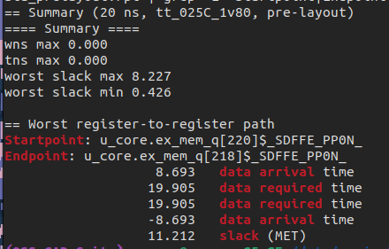
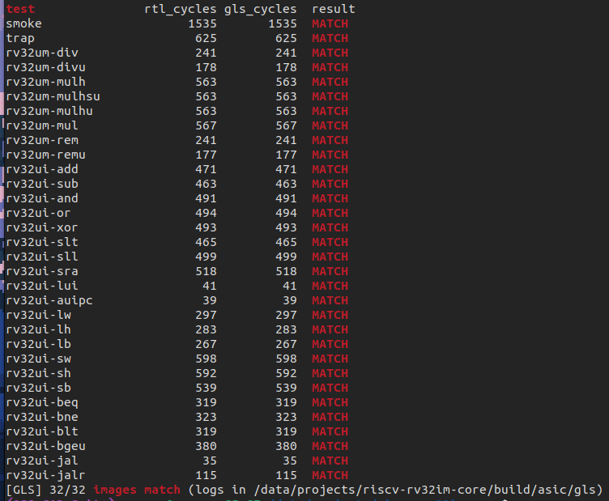
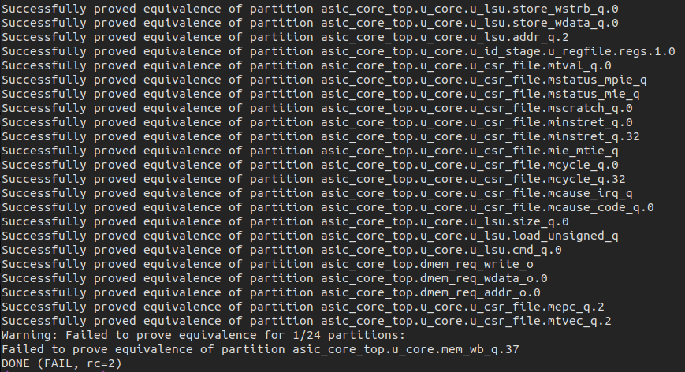
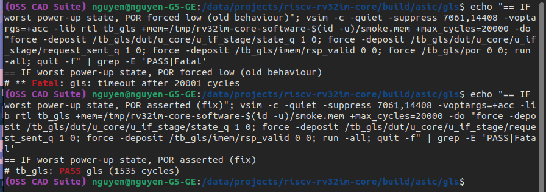

# ASIC Front-End Flow (sky130hd)

This document defines how the RV32IM core is taken through an open-source ASIC
front-end flow on the SkyWater 130 nm `sky130_fd_sc_hd` library, what each step
proves, and the results of the current revision. The same RTL drives the FPGA
target in [FPGA implementation](fpga.md); only the top-level wrapper and the
constraints differ.

The processor contract is defined in [Architecture](architecture.md) and the
RTL verification evidence in [Verification](verification.md). This flow checks
that the synthesized netlist preserves that RTL; it does not re-verify the RTL
against the RISC-V specification.

## 1. Scope and claim boundary

| Covered | Not covered |
|---|---|
| Bare `rv32_core` behind a flat-port wrapper | TCM/SRAM macros, SoC peripherals, I/O pads, power-on-reset circuit |
| Synthesis to `sky130_fd_sc_hd` cells | Floorplan, placement, CTS, routing, GDS (`make asic` exists but has not been run) |
| Pre-layout STA, typical corner only | Post-route timing, SPEF, multi-corner/PVT sign-off |
| Zero-delay gate-level simulation | SDF-annotated timing simulation |
| Logic equivalence RTL ↔ netlist (open-source) | Commercial LEC sign-off, DFT/scan, power analysis |

Every number below is a **pre-layout front-end** result at corner
`tt_025C_1v80` with a 20 ns SDC clock. It is not an Fmax claim and must not be
compared directly with the post-route 75 MHz FPGA result.

## 2. Toolchain

| Component | Version / source | Used for |
|---|---|---|
| OpenROAD-flow-scripts | Docker `openroad/orfs@sha256:a2715a86…5fd0` (pinned in the [Makefile](../Makefile)) | Synthesis driver, OpenSTA, cell-model generation |
| Yosys + slang | Inside the ORFS image | SystemVerilog frontend and technology mapping |
| PDK | `sky130hd` platform bundled with ORFS | Liberty `sky130_fd_sc_hd__tt_025C_1v80.lib`, LEF |
| Questa FSE 25.1 | Local install | 4-state gate-level simulation |
| eqy + bitwuzla | Local oss-cad-suite | Logic equivalence checking |

The Starter Edition of Questa is capacity-limited to 5,000 instances; the
netlist has about 18,000, so gate-level simulation is slower but functionally
unaffected.

## 3. Design boundary and constraints

| File | Role |
|---|---|
| [`asic/asic_core_top.sv`](../asic/asic_core_top.sv) | Flattens both `rv32_mem_if` ports into pins (a block boundary cannot carry an interface), exposes `por_i`, and leaves `trace_*`/`perf_*` unconnected so observability-only logic is removed |
| [`asic/config.mk`](../asic/config.mk) | ORFS design config: RTL list from `files/core.f`, `SYNTH_HDL_FRONTEND = slang`, `SYNTH_ARGS = -nofsm`, `CORE_UTILIZATION = 40` |
| [`asic/constraint.sdc`](../asic/constraint.sdc) | Clock `core_clk` on `clk_i`, default 20 ns (`CLK_PERIOD_NS` override); input and output delay 20% of the period on every I/O |

`-nofsm` keeps the RTL state encoding of the IF/LSU FSMs so LEC can pair
registers by name (see §7). The I/O delays are an assumed budget: I/O paths
report against it, while the core's own timing is the register-to-register
group.

## 4. Running the flow

| Command | Step | Main output in `build/asic/` |
|---|---|---|
| `make asic-synth` | Synthesis (ORFS stages `1_1_yosys_canonicalize`, `1_2_yosys`, `1_synth`) | `results/sky130hd/rv32im_core/base/1_2_yosys.v`, `reports/…/synth_stat.txt` |
| `make asic-sta` | Pre-layout STA on that netlist | `sta_prelayout.rpt` |
| `make asic-gls` | Gate-level simulation, RTL vs netlist | `gls/*.log`, per-program MATCH table |
| `make asic-lec` | Logic equivalence, RTL (gold) vs netlist (gate) | `lec.log`, `lec/core/` |
| `make asic-clean` | Remove ORFS results | — |

ORFS does not treat `asic/config.mk` as a dependency: after changing it or the
RTL, run `make asic-clean` before `make asic-synth`. `make asic-sta
CLK_PERIOD_NS=<ns>` re-times the existing netlist without re-synthesis.

`make asic-gls` runs every software and ISA image by default (54). The
representative set reported in §5.3 is selected with `GLS_IMAGES`:

```bash
I=/tmp/rv32im-core-isa-$(id -u); W=/tmp/rv32im-core-software-$(id -u)
make asic-gls GLS_IMAGES="$W/smoke.mem $W/trap.mem $(ls $I/rv32um-*.mem) \
  $(for t in add sub and or xor slt sll sra lui auipc lw lh lb sw sh sb beq bne blt bgeu jal jalr; do echo $I/rv32ui-$t.mem; done)"
```

## 5. Results

### 5.1 Synthesis

| Metric | Result |
|---|---:|
| Standard cells | 18,178 |
| Cell area | 176,111 µm² |
| Flip-flops | 2,534 |
| Yosys `check` | 0 problems |

| Largest cell types | Count | Area | Origin |
|---|---:|---:|---|
| `dfxtp_1` (flop) | 1,536 | ≈30.7k µm² | Pipeline registers, CSRs (64-bit `mcycle`/`minstret`), MDU state |
| `edfxtp_1` (enable flop) | 998 | ≈30.0k µm² | Register file, 31 × 32 bits |
| `fa_1` (full adder) | 1,130 | ≈22.6k µm² | 33 × 33 multiplier array |
| `mux4_2` | 564 | ≈12.7k µm² | Register-file read ports |

Flip-flops account for about 34% of cell area. On the FPGA the register file
maps to 44 LUTs as memory and the multiplier to four DSP48E1 slices
(`u_regfile` and `u_mul_unit` in the
[hierarchical utilization](hardware-validation.md#52-utilization)); on this
library both are built from standard cells.

### 5.2 Pre-layout timing (20 ns clock)

| Check | Result |
|---|---:|
| Setup WNS / TNS | 0.000 / 0.000 ns (no violation) |
| Worst setup slack, all paths | +8.227 ns |
| Worst setup slack, register-to-register | +11.212 ns |
| Worst hold slack | +0.426 ns |

The overall worst path ends at output `imem_req_valid_o`, so it is bounded by the
assumed 20% output budget. The worst register-to-register path runs from the
EX/MEM write-back selector through the forwarding decision
([`forwarding_unit.sv:36`](../rtl/core/forwarding_unit.sv#L36)), the operand
multiplexers, and the adder into the EX/MEM result register, requiring about
8.79 ns (≈114 MHz) **before layout**. Wire load, clock-tree insertion, and skew
are absent, so this figure is optimistic. The multiplier is registered
(`lhs_q`/`rhs_q` → result) and is not on the critical path.

<p align="center">
  <a href="images/asic_sta.png">
    
  </a>
</p>

<p align="center"><em>Pre-layout STA at 20 ns, tt_025C_1v80: no violations;
the worst register-to-register path arrives at 8.693 ns with +11.212 ns
slack.</em></p>

### 5.3 Gate-level simulation

Each program runs on the RTL and on the netlist with sky130 cell models generated
from the same liberty used for synthesis. Both runs must report PASS with the
same cycle count, and the testbench checks every cycle for X on bus valid and
address signals. Flops start at random 0/1 values (Questa `+initreg`, seed
`GLS_SEED`, default 1) to model power-up.

| Group | Programs | Result |
|---|---|---|
| Bare-metal | `smoke`, `trap` | 2/2 MATCH |
| RV32M | `mul`, `mulh`, `mulhsu`, `mulhu`, `div`, `divu`, `rem`, `remu` | 8/8 MATCH |
| RV32I ALU | `add`, `sub`, `and`, `or`, `xor`, `slt`, `sll`, `sra`, `lui`, `auipc` | 10/10 MATCH |
| RV32I load/store | `lw`, `lh`, `lb`, `sw`, `sh`, `sb` | 6/6 MATCH |
| RV32I control | `beq`, `bne`, `blt`, `bgeu`, `jal`, `jalr` | 6/6 MATCH |

Total: **32/32 MATCH** (seed 1, zero-delay). The four long benchmark programs and
the remaining ISA programs were not run on the netlist.

<p align="center">
  <a href="images/asic_gls.png">
    
  </a>
</p>

<p align="center"><em>Every program passes on both the RTL and the sky130
netlist with the same cycle count.</em></p>

### 5.4 Logic equivalence

| Metric | Result |
|---|---:|
| Partitions proven equivalent | **23 / 24** |
| Remaining partition | Basecase passes (no counterexample within 2 cycles); induction does not close |

The open partition is not a found mismatch. On the gold side it still holds
pipeline flops with no netlist counterpart, mostly `pc`/`insn` fields that only
feed the unconnected `trace_*` outputs; which of them blocks induction has not
been determined. Reported wording is "23/24 partitions proven", not "LEC passed".

<p align="center">
  <a href="images/asic_lec.png">
    
  </a>
</p>

<p align="center"><em>eqy proves 23 of 24 partitions; the remaining
<code>mem_wb_q.37</code> partition has no counterexample but its induction step does not
close, which eqy reports as <code>FAIL</code>.</em></p>

## 6. Findings fed back into the RTL

### 6.1 Power-on hang in the IF/LSU reset drain

The first gate-level run showed X on the bus `valid` signals directly after
reset. Tracing the fan-in cone led to `state_q`/`request_sent_q` in IF and LSU:
during reset, the warm-reset drain decided whether to wait for an outstanding
response by reading their pre-reset values. On silicon those values are random
after power-up, so the core could wait forever for a response to a request that
never existed. The FPGA never shows this because configuration (GSR) clears
every flop, and RTL simulation hides it because `if (X)` takes the false branch.

The fix adds `por_i`, a synchronous power-on reset asserted together with
`rst_i` after power-up; while it is high, IF and LSU reset to idle without the
drain ([`if_stage.sv:282`](../rtl/core/if_stage.sv#L282),
[`lsu.sv:227`](../rtl/core/lsu.sv#L227)). `fpga_top` ties it to 0. The contract is
in [Architecture §6.4](architecture.md#64-reset-contract).

| Replay on RTL (worst power-up state forced at 0 ns) | `por` asserted | `por` forced low |
|---|---|---|
| IF `BUSY`, `request_sent = 1`, `imem.rsp_valid = 0` | PASS, 1,535 cycles | timeout at 20,001 cycles |
| LSU `BUSY`, `request_sent = 1`, `dmem.rsp_valid = 0`, other flops random (seeds 1–3) | PASS, 1,535 cycles (all seeds) | timeout at 20,001 cycles |

<p align="center">
  <a href="images/asic_por_replay.png">
    
  </a>
</p>

<p align="center"><em>Same forced power-up state, IF case: without POR the core
times out; with POR it completes in the normal 1,535 cycles.</em></p>

The replay is currently run by hand with `force -deposit`; it is not yet part of
`make test`.

### 6.2 Constant-zero flops removed from the RTL

Synthesis already removes flops that can never leave their reset value; the RTL
was changed to stop describing them, which also lets LEC pair the remaining
state. Function and area are unchanged.

| Change | Reason |
|---|---|
| [`csr_file.sv`](../rtl/core/csr_file.sv) stores only `mstatus.MIE/MPIE`, `mie.MTIE`, `mcause[31]` and `mcause[4:0]` | All other bits are RO0 or single-value WARL; `mstatus_q`/`mie_q`/`mcause_q` remain 32-bit views |
| `TRAP_CAUSE_W = 4` ([`rv32_pkg.sv:242`](../rtl/core/rv32_pkg.sv#L242)) | Hardware raises codes up to 11, so bit 4 was constant 0 in every pipeline stage; `mcause` keeps its 5-bit WLRL field (`MCAUSE_CODE_W`) and `trace_cause_o` stays 5 bits |

## 7. Method notes

**Random power-up instead of X.** A 4-state simulator cannot resolve
reconvergent X: the D input of `if_stage.next_pc_q[5]` reduces during reset to
`!(t & !t)`, which is constant 1 in logic but evaluates to X. Starting flops at
random 0/1 values models silicon and avoids reporting correct reset logic as
stuck.

**LEC setup.** Commercial flows pair registers using guidance written by
synthesis; Yosys/ORFS produce none, so [`asic/run_lec.sh`](../asic/run_lec.sh)
declares each transformation explicitly:

| Issue | Symptom | Handling |
|---|---|---|
| Unused cell-model modules on the gate side | "unmatched module" | `hierarchy -purge_lib` |
| FSM re-encoding (LSU 2 → 3 bits) | Same register name, different meaning | `SYNTH_ARGS = -nofsm` |
| Cut point on a combinational output | Impossible counterexample (LSU busy, `valid` low) | `bind imem_req_*`, `bind dmem_req_*` |
| Reset-constant flops removed by synthesis | Induction failure | RTL changes in §6.2; `wreduce`/`opt` and a register-limited `opt_dff -sat` on the gold side |
| Output-alias register names (`mtvec_q` ↔ `csr_mtvec`) | Unpaired state | `gold-match` |

The gold-side optimizations assume the chip is reset before use, the same
assumption synthesis makes when removing constant flops. A global
`opt_dff -sat` was rejected because it removed a flop synthesis keeps
(`div_unit.iter_q[5]`).

## 8. Open work

- Run the back-end (`make asic`) for post-route timing, die area, and power.
- Close the last LEC partition, or bound it with a deep BMC from reset.
- Add the power-on replay of §6.1 to the `tb_if_stage`/`tb_lsu` regression.
- Run the long benchmark programs and FreeRTOS on the netlist.
- Add slow/fast corners and SDF-annotated simulation after layout.
